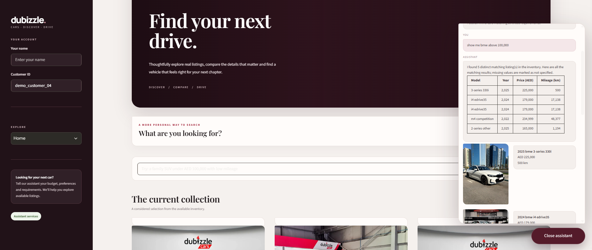
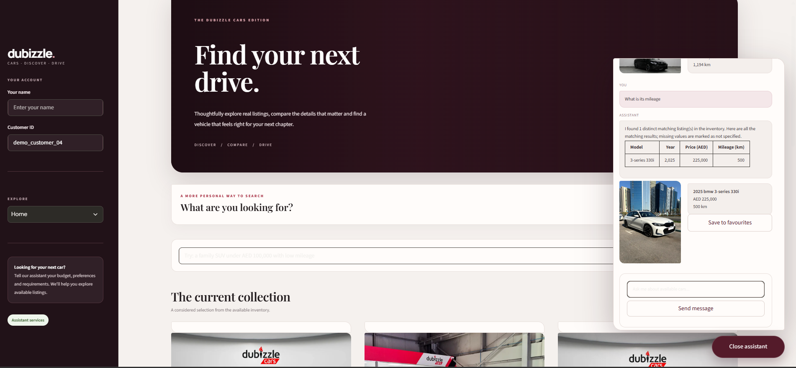
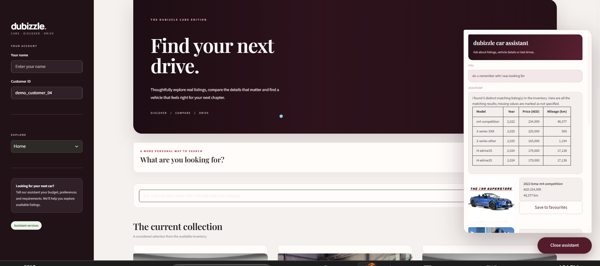

# dubizzle Cars AI Assistant

## Project overview

This project is a small AI assistant prototype for exploring the sample dubizzle Cars inventory. The aim was to make it easier for users to describe the type of car they are looking for, ask follow-up questions and request a test drive without having to search through every listing manually.

The assistant uses the provided sample car dataset and combines natural-language processing with structured filters to find relevant listings.

## What it can do

- Search the provided car inventory using natural-language queries and filters such as make, model, year, price, mileage and body type.
- Display matching listings using the information available in the dataset.
- Handle follow-up questions using recent conversation context.
- Store user preferences and previous interactions so returning users can be recognised through their user ID.
- Collect customer details and save enquiries as leads in a CSV file.
- Accept test-drive requests for Monday to Saturday, between 8:00 AM and 8:00 PM.
- Handle basic automotive questions and redirect requests that are outside the purpose of the assistant.

The backend also includes an endpoint for saving a car as a favourite.

This is a prototype using the supplied sample data. It is not connected to live dubizzle listings or a dealership's booking calendar.

## Technologies used

- **Python** – application logic.
- **FastAPI** – backend and API endpoints.
- **Streamlit** – user interface.
- **Groq API** – language-model responses and assistance with understanding user requests.
- **Pandas and scikit-learn** – inventory processing and text retrieval.
- **TF-IDF** – text matching using word and bigram features.
- **SQLite** – user profiles, preferences and conversation memory.
- **CSV files** – storing lead enquiries and test-drive requests.

## Project structure

```text
dubizzle-assistant/
├── app/
│   ├── api/
│   │   └── main.py
│   ├── database/
│   │   └── memory.py
│   └── services/
│       ├── inventory.py
│       ├── retrieval.py
│       ├── car_search.py
│       ├── query_understanding.py
│       ├── listing_details.py
│       └── bm25_retrieval.py
├── data/
│   └── Copy_of_sample_cars_dataset.xlsx
├── frontend/
│   └── app.py
├── screenshots/
│   ├── inventory-search.png
│   ├── multi-turn-chat.png
│   └── returning-user-memory.png
├── tests/
├── .env.example
├── .gitignore
├── pyproject.toml
└── README.md
```

The SQLite database and CSV files are generated by the application when it runs, so they may not be present in a fresh copy of the project.

## Setup

You will need Python 3.12 and a Groq API key.

**1. Clone the repository and open the project folder.**

```bash
git clone <your-public-repository-url>
cd dubizzle-assistant
```

**2. Create and activate a virtual environment.**

Windows PowerShell:

```powershell
python -m venv .venv
.\.venv\Scripts\Activate.ps1
```

macOS / Linux:

```bash
python -m venv .venv
source .venv/bin/activate
```

**3. Install the project dependencies.**

```bash
python -m pip install -e .
```

**4. Create a `.env` file in the project root and add your Groq API key.**

```env
GROQ_API_KEY=your_groq_api_key
GROQ_MODEL=openai/gpt-oss-20b
```

Keep the actual `.env` file private. Do not upload API keys to GitHub.

**5. Check that the supplied Excel inventory file is inside the `data/` folder.**

The application currently reads the `raw dataset` worksheet.

## Running the application

Start the FastAPI backend from the project root:

```bash
uvicorn app.api.main:app --reload
```

The API will be available at:

- `http://127.0.0.1:8000`
- API documentation: `http://127.0.0.1:8000/docs`

Open a second terminal, activate the same virtual environment and start Streamlit:

```bash
python -m streamlit run frontend/app.py
```

Streamlit will display a local address in the terminal, usually:

`http://localhost:8501`

## How the main parts work

### Inventory search

The inventory loader reads the supplied Excel file and prepares the listing fields for searching. The search service combines structured filters for fields such as make, model, year, price and mileage with text retrieval.

TF-IDF is used to compare the wording of a query with the available listing information. This allows the assistant to search the supplied inventory rather than relying on the language model to generate car listings.

Some rows in the sample dataset do not contain every field. Missing information is therefore treated as unavailable rather than guessed. The quality and completeness of the results also depend on the information provided in the dataset.

### Conversation and memory

The chat endpoint receives the user's message and ID. Recent conversation context is used to handle follow-up questions, while SQLite stores user-related information such as preferences and previous interactions.

Using the same user ID in a later session allows the application to retrieve that user's saved context. This provides a simple way to demonstrate returning-user memory without requiring a separate hosted database.

### Leads and test drives

Lead information is saved in `data/leads.csv`, while test-drive requests are saved in `data/bookings.csv`.

The booking validation accepts requests from Monday to Saturday, between 8:00 AM and 8:00 PM. Submitted requests are saved with a pending-confirmation status. The prototype does not connect to a live dealership calendar, check actual slot availability or guarantee an appointment.

## API endpoints

| Method | Endpoint | Purpose |
|---|---|---|
| GET | `/health` | Check whether the backend is running. |
| GET | `/memory/{user_id}` | Retrieve saved information for a user. |
| POST | `/cars/search` | Search the inventory using filters. |
| POST | `/chat` | Send a message to the assistant. |
| POST | `/cars/{car_index}/like/{user_id}` | Save a car as a favourite. |
| POST | `/leads` | Save a customer enquiry. |
| POST | `/bookings` | Submit a test-drive request. |

The full request and response formats are available in the FastAPI documentation at `/docs`.

## Design decisions

I chose Streamlit because I wanted the assistant to be usable through a simple interface rather than requiring users to send API requests manually. FastAPI keeps the search, chat and storage logic separate from the frontend, so the interface mainly sends requests and displays the results.

For retrieval, I used a combination of structured filters and TF-IDF text matching. The dataset contains fields such as make, year and price that can be filtered directly, while listing descriptions are more suitable for text matching.

SQLite was a practical choice for this prototype because it is local, does not require a separate database server and can retain information between sessions. Groq is used for the language-model component, while inventory retrieval is handled by the backend.

I also separated the project into services so that inventory loading, query understanding, car retrieval and memory management are not all handled in one file. This makes the different parts easier to work on and test.

## Limitations and possible improvements

There are a few areas I would improve with more time:

- Test and tune the search against a larger range of queries, particularly for car models and vehicle types described differently in listings.
- Add proper user authentication.
- Integrate with a dealership booking calendar to check available test-drive slots.

At the moment, the assistant works with the supplied sample inventory, and test-drive requests are recorded for confirmation rather than being confirmed automatically.

## Screenshots

The following screenshots show examples of the application running.

### Inventory search



### Multi-turn conversation



### Returning-user memory


